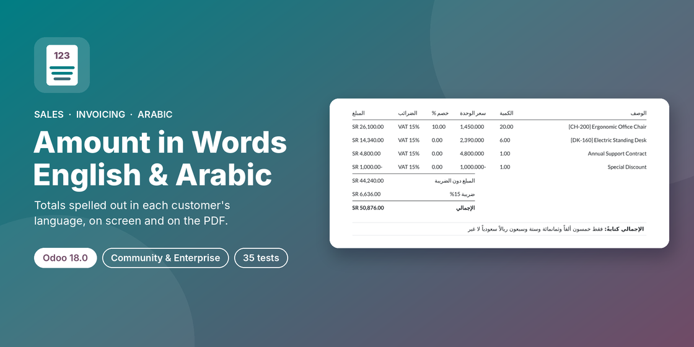

# Amount in Words – English & Arabic (Odoo 18.0)



Odoo module **`amount_in_words_multilingual`** — shows the total of every quotation, sales order and customer invoice spelled out in the **customer's language**, on screen and on the PDF. Arabic follows real grammar: dual, plural and accusative counted-noun forms, gender agreement and «فقط … لا غير».

> This branch: **Odoo 18.0** · Community & Enterprise · License LGPL-3

| Odoo version | Branch |
|---|---|
| 16.0 | [`16.0`](../../tree/16.0) |
| 17.0 | [`17.0`](../../tree/17.0) |
| 18.0 | [`18.0`](../../tree/18.0) |
| 19.0 | [`19.0`](../../tree/19.0) |

## Features

- **Total (In Words)** under the totals of sales orders and customer invoices / credit notes, recomputed live from quantities, prices, line discounts, total-discount lines, taxes (incl. tax-included prices) and cash rounding.
- Language taken from the customer (`partner_id.lang`), or forced to English / Arabic per company.
- Native English and Arabic engine (pure Python, no extra dependency); other languages fall back to Odoo's `amount_to_text`.
- Arabic grammar: `ريال سعودي واحد` · `ريالان سعوديان` · `خمسة ريالات سعودية` · `خمسون ريالاً سعودياً` · `مائتا ريال` · `ثلاث هللات` · `إحدى عشرة هللة`.
- Per-currency wording (English singular/plural; Arabic singular, dual, plural, accusative, feminine flag) on a new **Amount in Words** tab of each currency, pre-filled for 26 currencies (SAR, AED, KWD, QAR, OMR, BHD, EGP, USD, EUR …). Supports 0- and 3-decimal currencies.
- Printed on the standard **Quotation / Order** and **Invoices** reports, right-to-left for Arabic.
- Full Arabic translation (`ar_001`).

Example: `SAR 1,235.50` → *One Thousand Two Hundred and Thirty-Five Saudi Riyals and Fifty Halalas Only* / *فقط ألف ومائتان وخمسة وثلاثون ريالاً سعودياً وخمسون هللة لا غير*

## Installation

1. Copy the `amount_in_words_multilingual` folder into your addons path (or add this repository, branch `18.0`, on Odoo.sh).
2. Update the Apps list and install **Amount in Words (English & Arabic)**.
3. Depends only on `sale` and `account`.

## Configuration

- **Invoicing › Configuration › Settings › Amount in Words**: language mode (Customer's Language / Always English / Always Arabic), "Only / فقط … لا غير" wrapping, print on quotations/orders, print on customer invoices.
- **Invoicing › Configuration › Accounting › Currencies › Amount in Words** tab: edit the wording per currency, or **Reload defaults**.
- Set **Language** on each customer to get English or Arabic words.

## Developer API

```python
currency.amount_to_words_multilingual(1235.5, lang='ar_001', wrap=True)
```

Fields: `amount_total_words`, `amount_total_words_lang`, `amount_total_words_rtl` on `sale.order` and `account.move` (abstract model `amount.words.mixin`).

## Odoo 18 notes

- Same field takeover as on 17.0 (`account.move.amount_total_words`), never printed twice.
- Odoo 18 renamed the invoice totals key: the live grand total is read from `tax_totals['total_amount_currency']`.

## Tests

35 `TransactionCase` tests (engine grammar, rounding, currencies, discounts, taxes, cash rounding, credit notes, live form updates, rendered reports, Arabic label):

```bash
odoo-bin -d <db> -i amount_in_words_multilingual --test-enable --test-tags /amount_in_words_multilingual --stop-after-init
```

## Known limitations

- **`l10n_gcc_invoice`** (GCC bilingual invoice layout) prints `amount_total_words` under an English label. With this module that line follows the customer's language, so an Arabic customer sees Arabic text there. Not yet adapted.

## Author & support

**Ibrahim Yahia** · [LinkedIn](https://www.linkedin.com/in/ibrahim-yahia) · ibrahim.yahiah@gmail.com

License: [LGPL-3](https://www.gnu.org/licenses/lgpl-3.0.html)
